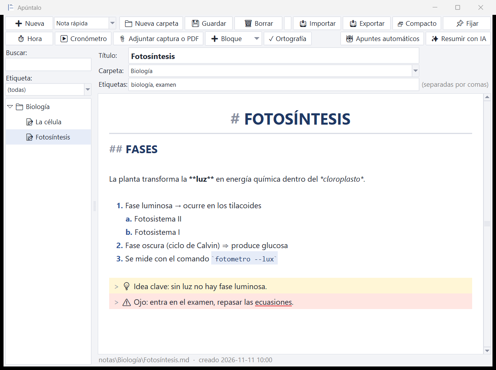

# Apúntalo ✏️

[](https://pypi.org/project/apuntalo/)
[](https://pypi.org/project/apuntalo/)
[](https://github.com/BV-cs0/apuntalo/blob/main/LICENSE)

**Toma nota de la clase.** Programa gratuito y de código abierto para sacar apuntes de clase en Windows, pensado para quien no tiene una herramienta para tomarlos. Escribes tus notas, o dejas que la app las tome sola de lo que se oye y se ve en la pantalla. Después las ordenas por asignatura y las exportas a PDF o a Word.



## Qué hace

- **Apuntes organizados**: una carpeta por asignatura, un apunte por clase, con etiquetas y buscador. Cada apunte es un archivo Markdown (`.md`) normal, así que tus apuntes son tuyos y se abren con cualquier editor.
- **Encima del vídeo de la clase**: la ventana se puede fijar siempre encima (📌), hacerse pequeña y semitransparente (🗗 Compacto), y mostrarse u ocultarse desde cualquier programa con **Ctrl+Alt+A**. Fijada sobre un vídeo a pantalla completa, puede esconder la barra de tareas de Windows mientras escribes (clic derecho en 📌).
- **Listas y esquemas como en Canva**: numeración automática con subniveles `a.` e `i.`, flechas (`->` da →), bloques de color (💡 idea, ⚠ ojo, ✅ resumen...) y **modo oscuro** (botón ☾). El título sale grande y centrado, y los comandos entre `comillas` en un recuadro.
- **✓ Corrector en español e inglés**: subraya en rojo las faltas mientras escribes y, con **F7**, te pregunta «¿Quieres corregir estas palabras?» con la sugerencia de cada una. No marca el código, los enlaces ni las siglas.
- **🤖 Apuntes automáticos**:
  - 🎧 Transcribe lo que se escucha con los *Subtítulos en directo* de Windows 11, sin internet.
  - 🖥 Guarda cada diapositiva nueva con su texto, leído con el OCR de Windows.
  - Puedes usar las dos cosas a la vez.
- **✨ Resumir con IA**: convierte la clase en apuntes ordenados (resumen, ideas clave, definiciones, tareas) con:
  - **ChatGPT**, gratis y sin claves: la app copia el texto y abre chatgpt.com; pegas, copias la respuesta y la app crea el apunte.
  - **Google Gemini**, con una clave gratuita de [Google AI Studio](https://aistudio.google.com/apikey). En el plan gratuito, Google puede usar los textos para mejorar sus productos.
  - **Claude** (Anthropic), con una clave de pago de [console.anthropic.com](https://console.anthropic.com). Cuesta unos céntimos por clase.
- **📤 Exportar**: un apunte, una asignatura entera o todo. Eliges el formato (*Guardar como*) y la carpeta (*Guardar en*):
  - **PDF**, para imprimir o enviar.
  - **Word (.docx)** y **OpenDocument (.odt)**, para seguir editando en Word, Google Docs o LibreOffice.
  - **Página web (.html)**, que se abre en cualquier navegador con las imágenes dentro.
  - **Markdown (.md)**, para Obsidian, Notion o GitHub.
  - **Texto sin formato (.txt)**.
- **📥 Importar**: trae tus apuntes de Word (.docx), LibreOffice (.odt), páginas web (.html), Markdown (.md) o texto (.txt) para seguir editándolos aquí. Conserva títulos, negritas, cursivas, listas, tablas e imágenes.
- **🖼 Imágenes con Ctrl+V**: haz un recorte con Win+Shift+S (o copia una imagen) y pégalo en el apunte. En el editor se ve solo la imagen, y sale también al exportar. Para quitarla, pulsa Retroceso justo detrás de ella.
- **⏱ Marcas de tiempo, ▶ cronómetro y 📎 adjuntar capturas o PDF.**

## Instalar

Hay dos formas. Elige la que te resulte más cómoda.

### Opción 1: descargar el programa (`.exe`), la más fácil

1. Descarga `Apuntalo.exe` desde [**Releases**](https://github.com/BV-cs0/apuntalo/releases/latest).
2. Guárdalo en una carpeta tuya (por ejemplo, `Documentos\Apuntes`).
3. **Ábrelo como administrador**: clic derecho en `Apuntalo.exe` → **Ejecutar como administrador**. Es necesario para que todas las funciones (atajos globales, captura de pantalla y subtítulos en directo) funcionen bien. Tus apuntes se guardan en `notas/`, al lado del `.exe`, así que puedes llevarlo en un pendrive.

> ⚠️ **Es necesario ejecutar Apúntalo como administrador.** Para no tener que hacerlo cada vez: clic derecho en `Apuntalo.exe` → *Propiedades* → *Compatibilidad* → marca **«Ejecutar este programa como administrador»** → *Aceptar*.

Al abrirlo puede pasar esto:
- Windows avisa con «Windows protegió su PC» porque el programa no está firmado: pulsa *Más información* → *Ejecutar de todas formas*.
- Si tienes activado el **Control inteligente de aplicaciones** de Windows 11, puede que el `.exe` quede bloqueado. En ese caso usa la opción 2.

### Opción 2: instalar con Python (`pip`)

Apúntalo está en [PyPI](https://pypi.org/project/apuntalo/).

Necesitas [Python 3.10 o superior](https://www.python.org/downloads/). Al instalarlo, marca «Add python.exe to PATH». Después abre una terminal y escribe:

```
py -m pip install apuntalo
```

Para abrirlo, escribe `py -m apuntalo` en una terminal **abierta como administrador** (o solo `apuntalo`, si Windows no lo bloquea). Tus apuntes se guardan en `Documentos\Apuntalo`.

- Para el resumen con Claude: `py -m pip install "apuntalo[claude]"`.
- Para actualizar a la última versión: `py -m pip install -U apuntalo`.

### Opción 3: desde el código

Descarga el código y abre **`Abrir apuntes.bat`** con clic derecho → *Ejecutar como administrador*. Los apuntes se guardan en la propia carpeta del proyecto.

> En las tres opciones puedes elegir otra carpeta para los apuntes con la variable de entorno `APUNTALO_DATOS`.

## Atajos

| Tecla | Acción |
|---|---|
| Ctrl+N / Ctrl+S | Nuevo apunte / Guardar |
| Ctrl+F | Buscar |
| Ctrl+V | Pegar texto o **imágenes**: un recorte (Win+Shift+S), una imagen copiada del navegador o archivos copiados en el Explorador. Se guardan en los adjuntos del apunte y se ven dentro del texto |
| Ctrl+T | Insertar la hora, o el minuto del vídeo si el cronómetro está en marcha |
| Ctrl+E | Exportar (PDF, Word, OpenDocument, web, Markdown o texto) |
| Ctrl+I | Importar apuntes de otros programas |
| F8 | Empezar o parar los apuntes automáticos |
| F9 / F10 | Fijar encima / Modo compacto |
| Ctrl+Alt+A | Mostrar u ocultar la ventana desde cualquier programa |
| Ctrl + / Ctrl - / Ctrl 0 (o Ctrl + rueda) | Letra más grande / más pequeña / normal |
| Ctrl+Retroceso / Ctrl+Supr | Borrar la palabra entera a la izquierda / a la derecha |
| Ctrl+B / Ctrl+K | **Negrita** / *cursiva* (con texto seleccionado lo envuelve) |
| Enter en una lista | Siguiente elemento (`1.` → `2.`, `a.` → `b.`). En un elemento vacío, termina la lista |
| Tab / Mayús+Tab | Bajar o subir un nivel de la lista (`1.` → `a.` → `i.`) |
| Retroceso tras la viñeta | En `2.` vacío pasa a `a.`; en `a.` vuelve al número; otra vez, quita la viñeta |
| `->` `=>` `<=` `!=` `...` + espacio | Se convierten en → ⇒ ≤ ≠ … (Ctrl+Z lo deshace) |
| `/idea` `/ojo` `/resumen` `/nota` `/pregunta` `/definicion` + espacio | Bloque destacado de color (también en el botón ➕ Bloque) |
| F7 | Revisar la ortografía: «¿Quieres corregir estas palabras?» con la sugerencia de cada una (también en ✓ Ortografía) |
| Clic derecho en una palabra subrayada | Sugerencias, o «Añadir a mi diccionario» para que no se marque más |
| Clic derecho en 📌 Fijar | Ocultar la barra de tareas mientras escribes sobre un vídeo a pantalla completa |

Mientras escribes, el editor colorea el formato: títulos, **negritas**, *cursivas*, `código`, citas, tareas hechas y marcas de tiempo. Además:
- Se guarda solo cada 15 segundos, al cambiar de apunte y al cerrar.
- Al abrir la app vuelve al último apunte en el que estabas.
- Corrector en **español e inglés a la vez**: subraya en rojo lo mal escrito, pero no el código entre `comillas`, los enlaces, las rutas ni las siglas. Usa el diccionario de Windows; si a Windows le falta el inglés, usa `pyspellchecker` (va incluido en el `.exe`; con pip: `pip install apuntalo[ortografia]`).

## Apuntes automáticos: detalles

- **Audio**: la primera vez que se usan los Subtítulos en directo de Windows, hay que aceptar su aviso de privacidad y descargar el idioma. Captan el sonido del PC (el vídeo o la videollamada) y, si se activa en los subtítulos, también el micrófono.
- **Pantalla**: con **✂ Elegir zona del vídeo** recortas solo el vídeo o las diapositivas, y el texto sale mucho más limpio. La ventana de Apúntalo no aparece en las capturas.
- **Ventana encima del vídeo**: funciona sobre vídeos en ventana y sobre la pantalla completa del navegador. No puede ponerse encima de un programa en pantalla completa *exclusiva*.
- **Respeta a los demás**: pide permiso antes de grabar o transcribir una clase o una reunión.

## Privacidad

Tus apuntes se quedan en tu PC. Solo salen de él si usas **Resumir con IA**: con ChatGPT los pegas tú; con Gemini o Claude, la app envía el texto del apunte a ese servicio. Las claves de API se guardan en `config.json`, en tu PC, y nunca se suben al repositorio.

## Estructura del código

| Archivo | Qué hace |
|---|---|
| `apuntalo/app.py` | La aplicación (Python + tkinter, solo con la biblioteca estándar). |
| `apuntalo/editor.py` | Lógica del editor sin ventanas: listas que se numeran solas, Tab y Retroceso en listas, borrar palabras, flechas y bloques. |
| `apuntalo/ortografia.py` | Corrector en español e inglés con el diccionario de Windows (por COM, con `ctypes`) y `pyspellchecker` de respaldo. |
| `apuntalo/exportar.py` | Exportar a PDF (imprimiendo HTML con Microsoft Edge), DOCX y ODT (generados a mano), HTML, Markdown y texto. |
| `apuntalo/importar.py` | Importar DOCX, ODT, HTML, Markdown y texto, convirtiéndolos a Markdown. |
| `apuntalo/portapapeles.py` | Leer imágenes y archivos copiados (Ctrl+V) sin librerías externas. |
| `apuntalo/captura.ps1` | Ayudante de PowerShell para el modo automático: lee los Subtítulos en directo y hace capturas con OCR. |
| `apuntes.pyw` | Lanzador para abrir la app desde el código con doble clic. |
| `crear_exe.bat` | Genera `Apuntalo.exe` con PyInstaller. |
| `pyproject.toml` | Configuración del paquete de PyPI (`pip install apuntalo`). |

## Contribuir

¡Las contribuciones son bienvenidas!

1. Abre un *issue* para contar el error o la idea.
2. Haz un *fork*, crea una rama y envía un *pull request* con una descripción breve.
3. Mantén la app sin dependencias obligatorias: debe funcionar solo con Python y Windows. Las dependencias opcionales, como `anthropic`, se importan solo cuando se usan.
4. Escribe la interfaz y los mensajes en español, claros para alguien que no sabe de informática.

Antes de enviar cambios, pasa las pruebas desde la carpeta del proyecto: `py -3 -m unittest -v`.

Para generar el `.exe`: `py -3 -m pip install -r requirements.txt` y después ejecuta `crear_exe.bat`.

### Publicar una versión nueva (mantenedores)

1. Sube el número en `apuntalo/__init__.py` (`__version__`).
2. Crea una *Release* en GitHub con la etiqueta `vX.Y.Z` y adjunta el `Apuntalo.exe` nuevo.
3. Para subirlo a PyPI: *Actions* → **Publicar en PyPI** → *Run workflow* (`.github/workflows/publicar.yml`). Usa *Trusted Publishing*, sin contraseñas ni tokens. PyPI no deja volver a subir un número de versión que ya existe.

## Qué probar (lista para la versión 1.1)

- [ ] **Abrir:** doble clic en `Apuntalo.exe` (o en `Abrir apuntes.bat`). La ventana se abre y, la segunda vez, vuelve al último apunte.
- [ ] **pip:** `py -m pip install apuntalo` y después `py -m apuntalo`. Se abre y guarda los apuntes en `Documentos\Apuntalo`.
- [ ] **Organizar:** crea la carpeta `Matemáticas/Tema 1` y un apunte con la plantilla *Clase / estudio*. Ponle etiquetas y búscalo con Ctrl+F.
- [ ] **Formato:** escribe `# Título`, `**negrita**` y `- [x] tarea` y comprueba que se colorean. Prueba Ctrl + y Ctrl - para cambiar el tamaño de la letra.
- [ ] **Imágenes:** haz un recorte con Win+Shift+S y pulsa Ctrl+V en un apunte. Se ve solo la imagen, sin el texto `![...]`. Pulsa Retroceso detrás de ella y desaparece entera. Copia texto normal y comprueba que Ctrl+V sigue pegando texto.
- [ ] **Exportar a todo:** Ctrl+E, cambia *Guardar en* con los botones (Escritorio, Documentos...) y exporta el mismo apunte en los seis formatos. Abre el `.odt` en LibreOffice y el `.html` en el móvil.
- [ ] **Importar:** Ctrl+I y elige un Word tuyo de verdad (con títulos, listas e imágenes). Se crea un apunte con la etiqueta `importado` que puedes editar.
- [ ] **Autoguardado:** escribe algo, espera 15 segundos y cierra la app desde el Administrador de tareas. Al volver a abrirla, el texto sigue ahí.
- [ ] **Sobre un vídeo:** pon un vídeo de YouTube y pulsa F9 (fijar) y F10 (compacto). Ajusta la transparencia y prueba Ctrl+Alt+A desde el navegador.
- [ ] **Automático con audio:** F8, marca solo 🎧 y pon un vídeo con voz. Comprueba que el texto aparece en párrafos con su `[hh:mm:ss]` y sin repeticiones.
- [ ] **Automático con pantalla:** F8, marca 🖥 y elige con ✂ la zona de unas diapositivas. Cambia de diapositiva y comprueba que aparece una captura con su texto.
- [ ] **ChatGPT:** ✨ Resumir con IA → ChatGPT. Pega en chatgpt.com, copia la respuesta y pulsa «Crear apunte con la respuesta».
- [ ] **Gemini:** crea una clave gratis en aistudio.google.com/apikey y usa ✨ Resumir con IA → Gemini.
- [ ] **Exportar:** Ctrl+E y exporta a PDF y a Word un apunte y una asignatura entera. Abre el `.docx` en Word, LibreOffice o Google Docs y comprueba que se ve bien.
- [ ] **Compacto:** al pasar a modo compacto (F10), todos los botones de la barra pequeña funcionan.

## Licencia

[MIT](https://github.com/BV-cs0/apuntalo/blob/main/LICENSE): puedes usarlo, copiarlo, modificarlo y compartirlo libremente.
